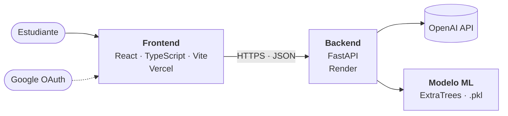
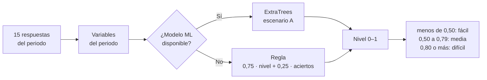

<div align="center">

# Cursa AI

### Estudia mejor con una plataforma que se adapta a ti

Convierte tus apuntes y PDF en resúmenes, preguntas de práctica, pruebas cronometradas y mapas conceptuales.<br>
Un modelo de Machine Learning estima tu nivel y ajusta la dificultad en cada periodo.

<br>

[](https://plataforma-estudio-ai.vercel.app)


</div>

<br>

## Contenido

[Qué hace](#qué-hace) · [Arquitectura](#arquitectura) · [Motor adaptativo y ML](#motor-adaptativo-y-ml) · [Puesta en marcha](#puesta-en-marcha) · [API](#api) · [Estructura](#estructura-del-repositorio) · [Pruebas](#pruebas) · [Privacidad y seguridad](#privacidad-y-seguridad) · [Despliegue](#despliegue)

<br>

## Qué hace

Cada tema de estudio nace de un texto o de un PDF y se trabaja con cuatro módulos:

| Módulo | Qué obtienes | Cómo funciona |
|---|---|---|
| **Resumen** | Un resumen esencial y uno general, descargables en PDF | Una sola llamada a OpenAI genera ambos. Los PDF se analizan completos, con tablas y gráficos |
| **Preguntas** | Práctica de opción múltiple con corrección y explicación | La IA genera preguntas a partir del resumen general; el backend descarta las que no tienen fundamento literal, son ambiguas o están duplicadas |
| **Prueba** | Evaluación cronometrada de hasta 25 preguntas | El servidor lleva el reloj y califica; el navegador no recibe la respuesta correcta hasta finalizar. Tiempo configurable en pasos de 5 min o sin límite |
| **Mapa conceptual** | Mapa de nodos y relaciones, exportable | La IA propone el mapa desde la fuente; el backend lo valida (una raíz, sin ciclos ni huérfanos) y el frontend calcula las posiciones |

Además:

- **Progreso**: evolución del nivel por periodos, dominio por tema, puntos débiles y distribución de dificultad.
- **Acceso solo con Google** (OAuth 2.0 / OIDC): sin contraseñas propias ni formulario de registro.
- **Apariencia**: modo claro y oscuro con esquemas de color.
- **Buddy**: asistente con guías y tutoriales dentro de la app.

<br>

## Arquitectura



Reglas de diseño:

- **El backend es el único que habla con OpenAI.** El frontend nunca recibe la clave.
- **Sin base de datos.** El servidor procesa cada solicitud en memoria y no guarda textos, PDF ni resúmenes. El estado de una prueba viaja cifrado (Fernet) hacia el cliente y se valida al volver.
- **Servicios desacoplados.** Los casos de uso dependen del contrato `ProveedorIA`, no de OpenAI, por lo que se prueban con un proveedor falso sin gastar créditos.

<br>

## Motor adaptativo y ML

La práctica se organiza en **periodos de 15 preguntas**. Al cerrar cada periodo, el backend estima el nivel de conocimiento (0 a 1) y fija la dificultad de las siguientes preguntas.



| | Escenario A (en uso) | Escenario B (no integrado) |
|---|---|---|
| Objetivo | Estimar el nivel al cierre del periodo | Anticipar el nivel con periodos anteriores |
| Modelo | `ExtraTreesRegressor` | `HistGradientBoostingRegressor` |
| MAE · R² en prueba | **0,0335 · 0,886** | 0,0565 · 0,714 |

- **Dataset:** `dataset_ml_nivel_conocimiento_125k.csv`, 125 000 filas × 36 columnas. Es un conjunto **sintético**: las métricas miden el desempeño sobre esos datos, no sobre estudiantes reales.
- **Evaluación:** partición por estudiante (sin estudiantes compartidos entre entrenamiento y prueba) y validación cruzada por grupos.
- **Nivel inicial:** 0,57. Si el modelo no carga, el motor usa la regla y lo registra en el log (`fuente: "regla"`).
- **Compatibilidad:** el `.pkl` exige **scikit-learn 1.6.1**.

El notebook `ml/modelo_nivel_conocimiento.ipynb` contiene la auditoría de datos, la comparación de modelos, la optimización y la evaluación completas. Detalle de los artefactos en [`ml/README.md`](ml/README.md).

<br>

## Puesta en marcha

**Requisitos:** Python 3.11 o superior, Node.js 18 o superior, una clave de OpenAI y un ID de cliente de Google (tipo «Aplicación web»).

**1. Backend**

```bash
cd backend
python -m venv .venv
.venv\Scripts\activate            # macOS/Linux: source .venv/bin/activate
pip install -r requirements-dev.txt
copy .env.example .env            # macOS/Linux: cp .env.example .env
uvicorn app.main:app --reload --port 8000
```

Completa en `backend/.env` al menos `OPENAI_API_KEY` y `OPENAI_MODEL`. Documentación interactiva en `http://localhost:8000/docs`.

**2. Frontend**

```bash
cd frontend
npm install
cp .env.example .env.local        # completa VITE_GOOGLE_CLIENT_ID
npm run dev
```

Abre `http://localhost:5173`.

### Variables de entorno

| Variable | Dónde | Descripción |
|---|---|---|
| `OPENAI_API_KEY` | backend | Clave de OpenAI. Obligatoria |
| `OPENAI_MODEL` | backend | Modelo a usar. Obligatoria, sin valor por defecto |
| `PRUEBAS_CLAVE_SECRETA` | backend | Clave que cifra el estado de las pruebas. Si falta, se usa una temporal y las pruebas en curso se pierden al reiniciar |
| `ORIGENES_PERMITIDOS` | backend | Orígenes CORS separados por comas, sin barra final |
| `MODELO_NIVEL_RUTA` | backend | Ruta del `.pkl`. Vacía usa el del repositorio |
| `VITE_URL_BASE_API` | frontend | URL del backend. Por defecto `http://localhost:8000` |
| `VITE_GOOGLE_CLIENT_ID` | frontend | ID de cliente OAuth de Google. Es público; nunca pongas un secreto de cliente |

La lista completa, con límites y tiempos de espera opcionales, está en [`backend/.env.example`](backend/.env.example) y [`backend/README.md`](backend/README.md).

<br>

## API

Todas las respuestas usan el mismo formato: `{ "exito": true, "datos": {…} }` o `{ "exito": false, "error": { "codigo", "mensaje" } }`.

| Módulo | Endpoints |
|---|---|
| Sistema | `GET /api/salud` |
| Resúmenes | `POST /api/resumenes` · `/pdf` · `/descargar-pdf` |
| Preguntas | `POST /api/preguntas/generar` |
| Pruebas | `POST /api/pruebas/` `crear` · `iniciar` · `estado` · `sincronizar` · `pausar` · `reanudar` · `finalizar` |
| Mapas conceptuales | `POST /api/mapas-conceptuales` · `/pdf` |
| Adaptación | `POST /api/adaptacion/registrar` |
| Contenido | `POST /api/contenido/extraer-pdf` |

Contratos, errores y ejemplos en [`backend/README.md`](backend/README.md).

<br>

## Estructura del repositorio

```text
.
├── backend/                 FastAPI
│   ├── app/
│   │   ├── resumenes/       Resumen esencial y general, exportación a PDF
│   │   ├── preguntas/       Generación y validación de preguntas
│   │   ├── pruebas/         Pruebas cronometradas, calificación, estado cifrado
│   │   ├── mapas_conceptuales/
│   │   ├── adaptacion/      Motor adaptativo y carga del modelo de ML
│   │   ├── contenido/       Extracción y validación de texto y PDF
│   │   └── servicios_externos/  Contrato ProveedorIA y cliente OpenAI
│   ├── pruebas/             Suite de pytest
│   └── scripts/             Validación manual con OpenAI real
├── frontend/                React + TypeScript + Vite
│   └── src/                 paginas · componentes · servicios · almacen · hooks · estilos · buddy
├── ml/                      Notebook y artefactos .pkl del modelo
└── dataset_ml_nivel_conocimiento_125k.csv
```

<br>

## Pruebas

```bash
cd backend  && pytest            # no llama a OpenAI
cd frontend && npm test          # Vitest
cd frontend && npm run build     # tsc + vite build
```

El backend cuenta con más de 200 pruebas y el frontend con más de 150.

<br>

## Privacidad y seguridad

- La sesión de estudio vive **en memoria**: al recargar o cerrar la pestaña se pierde. Es una decisión de diseño.
- El perfil de Google (nombre, correo, foto) no se guarda en `localStorage`, `sessionStorage` ni cookies.
- `OPENAI_API_KEY` vive solo en `backend/.env`, ignorado por git. El repositorio incluye únicamente `.env.example`.
- Todo lo que empieza por `VITE_` termina en el navegador: nunca pongas ahí secretos.
- Los `.pkl` se cargan con `joblib`, que ejecuta código al abrir el archivo: usa solo los de este repositorio.

<br>

## Despliegue

| Parte | Plataforma | Nota |
|---|---|---|
| Frontend | Vercel | `frontend/vercel.json` reescribe todas las rutas a `index.html` |
| Backend | Render | El plan gratuito se suspende: la app muestra una pantalla de inicialización que consulta `/api/salud` con reintentos hasta que el servidor despierta |

En Render, `ORIGENES_PERMITIDOS` debe incluir la URL exacta del frontend.

<br>

<div align="center">

**Cursa AI** · Proyecto académico

</div>
